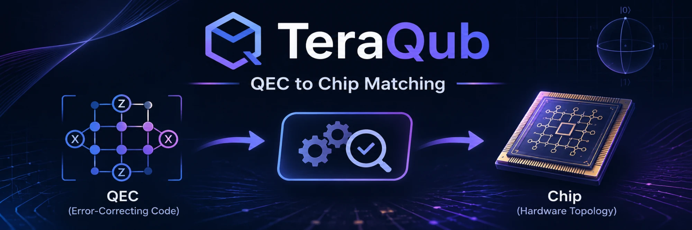

<p align="center">
  
</p>

# TeraQube / ArQiteQ

**TeraQube / ArQiteQ** takes a *specified, not-yet-fabricated* superconducting
quantum chip stack — substrate, host material, dopant, QEC code, code distance —
and certifies whether it can run quantum error correction below a target logical
error rate. It returns a **PASS / MODERATE / FAIL** verdict derived from material
physics, before a single wafer is etched.

It does this by following the full causal chain end to end:

```
material + dopant → Gibbs ΔG → TLS density → T1/T2 → physical error
       → logical error (MWPM + GNN decoder) → PASS / MODERATE / FAIL
```

and, in parallel, runs a small exact **quantum simulation** (ground state of a
chosen Hamiltonian) so you can see how close a chip of this quality would land to
the true answer.

**Live site:** https://teraqub-ten.vercel.app/  
**2-minute demo video:** https://teraqub-ten.vercel.app/teraqube_demo.mp4

---

## Two surfaces

### 1. The live tool — `arqiteq_v9.html`
A single self-contained web app. Pick a chip stack on the left; the right panel
shows, live:

- **Material stability** — a COMSOL-style Gibbs ΔG field over the chip layers,
  with click-to-dope on the material lattice.
- **QEC certification** — physical/logical error, threshold margin, GNN-decoded
  verdict.
- **Joint search (QUBO)** — searches qubit × code × material × geometry × distance
  for a passing configuration.
- **Quantum simulation** — solves the ground state and shows the Hamiltonian in
  operator form next to a **dynamical energy well**: a ball rolling into the
  ground state, with the time-to-convergence τ. (See "Ground-state relaxation".)
- **Compute benchmark** — the I-PINN → PINN → QUBO pipeline cost across CPU / GPU.

### 2. The Python engine — `teraqube/`
The same physics as a clean, tested package. Reproduces the tool's numbers
exactly (18 passing tests).

| module | what it does |
|---|---|
| `catalogs.py` | material / code / hardware data — single source of truth |
| `material_properties.py` | typed accessors over the catalogs |
| `noise.py` | `stack_floor`, `phys_err`, `logical_err` |
| `gnn_decoder.py` | AlphaQubit-style GNN decoder gain over MWPM |
| `gibbs_sampler.py` | Gibbs ΔG of the doped lattice + fast scorer |
| `physics.py` | coherence → errors → logical error → `evaluate` / `tier_of` |
| `qec_topology.py` | `qec_nodes`, `code_weight`, `code_family`, `phys_qubits` |
| `qubo_search.py` | joint search (`q_greedy`, `q_anneal`) |
| `pipeline.py` | the **I-PINN → PINN → QUBO** flow, chained (`run_pipeline`) |
| `quantum_sim.py` | exact ground state, observables, `energy_landscape` |
| `benchmark.py` | measured CPU / GPU / GPU-cluster TFLOPS + comparator |
| `qpu_select.py` | score the live IBM fleet by fidelity + queue |
| `qpu_agent.py` | AI agent that picks the best IBM QPU |
| `report.py` | push results to Composio → Google Sheets |

---

## Quick start

```bash
pip install -e .                 # core engine (numpy only)
python -m teraqube.demo          # certify a sample chip
python -m pytest -q              # 18 tests, reproduce reference numbers

# optional capabilities
pip install -e ".[benchmark]"    # qiskit-ibm-runtime  → real QPU metrics
pip install -e ".[agent]"        # anthropic           → best-QPU AI agent
pip install -e ".[report]"       # composio            → push to Google Sheets
```

```python
from teraqube import evaluate, tier_of
e = evaluate('transmon', 'tantalum_cap', 'none', 'surface', 5, {'substrate': 'sapphire'})
print(tier_of(e, target=1e-6))   # PASS / MODERATE / FAIL
```

---

## Compute benchmark — CPU + GPU cluster

The benchmark **measures** FLOPS; nothing is hardcoded. Run it on the machine you
want to cite (a CPU box, or a Nebius GPU / HGX node):

```bash
pip install cupy-cuda12x                 # or torch, for GPU
python scripts/run_benchmarks.py         # writes scripts/benchmark.json
```

- **CPU** FLOPS are always reported.
- If a **GPU** is present, the CPU-vs-GPU(-cluster) **comparator** is added with
  speedup factors (`compare_backends()`); a multi-GPU node reports per-GPU plus
  aggregate throughput.
- `scripts/benchmark_report.html` renders the comparison.

A QPU has no FLOPS, so it is **not** benchmarked for speed — it is *selected*
(below).

### Running on Nebius
1. Launch a GPU VM in the Nebius console (Ubuntu CUDA image — drivers preinstalled).
2. `git clone` this repo, `pip install -e .`, `pip install cupy-cuda12x`.
3. `python scripts/run_benchmarks.py`, then `scp` `benchmark.json` back.

Nebius only supplies the machine; the benchmark itself is plain Python.

---

## Best-QPU AI agent — IBMQ

```bash
export IQP_API_TOKEN=...          # IBM Quantum 44-char key
export ANTHROPIC_API_KEY=...      # for the agent's reasoning
python -c "from teraqube.qpu_agent import pick_qpu_agent as p; \
print(p('need >=20 qubits, best fidelity, speed irrelevant')['answer'])"
```

The agent turns a plain-English requirement into ranking weights, calls the live
IBM fleet via `qiskit-ibm-runtime`, scores each backend (qubits, 2-qubit gate
error, queue depth, readout error), and recommends the winner with its reasons.
The *selection* is deterministic and auditable; the LLM only handles the fuzzy
requirement→weights step.

---

## Reporting — Composio → Google Sheets

```bash
export COMPOSIO_API_KEY=...        # connect Google Sheets in Composio first
python -c "from teraqube.report import send_v9_results; \
print(send_v9_results(user_id='you@example.com', benchmark={}, qpu={}))"
```

Writes the certification, benchmark, and QPU-selection results into three
**separate Google Sheets**. Composio is an optional reporting layer only — it is
never in the compute path.

---

## Ground-state relaxation (the "ball on a hill")

After the quantum simulation solves the ground state, the tool shows the
Hamiltonian in operator form beside a **dynamical energy well**. The physics is
real: along the geodesic between the ground and top eigenstates the energy is an
exact cosine well

```
⟨H⟩(θ) = E₀ + sin²(θ/2)·(E_top − E₀)
```

whose floor is the true ground-state energy E₀. A **damped pendulum in that well**
(`θ'' = −k·sinθ − γ·θ'`) relaxes to the bottom — so the ball rolling into the
valley *is* the system relaxing to its ground state. The readout shows the
convergence time **τ**. `energy_landscape(sim, N)` in the engine returns the well,
the timed trajectory, and the observables; a standalone view lives at
`scripts/quantum_sim_viz.html`.

---

## The I-PINN → PINN → QUBO pipeline

The tool's compute flow is three chained stages, and `teraqube/pipeline.py`
implements it as real, runnable code (not just a UI label):

| stage | engine call | role |
|---|---|---|
| **I-PINN** | `gibbs_sampler.config_score` | fast doping/material screen — cheap triage, no full physics |
| **PINN** | `physics.evaluate` + `tier_of` | full physics solve → PASS / MODERATE / FAIL |
| **QUBO** | `qubo_search.q_greedy` / `q_anneal` | joint search over the stack, warm-started from the PINN config |

Each stage feeds the next: I-PINN picks a promising dopant, PINN verifies it with
the full causal chain, and QUBO searches the space (warm-started from that config)
for the lowest-qubit passing stack.

```python
from teraqube import run_pipeline
r = run_pipeline(verbose=True)
# I-PINN  best dopant=fluorine doping=0.3 score=0.369
# PINN    verdict=FAIL pL=4.26e-03
# QUBO    best qubits=721 pass=True
```

## Repo structure

```
arqiteq_v9.html              the live single-file tool
teraqube/                    the Python engine (see table above)
tests/                       pytest suite (18 tests)
scripts/
  run_benchmarks.py          CPU/GPU/cluster benchmark → benchmark.json
  benchmark_report.html      CPU-vs-GPU comparator view
  quantum_sim_viz.html       standalone ground-state relaxation view
src/  base44/  ...           Base44 React frontend (when used as the app)
logo-mark.svg  logo-horizontal.svg
```

---

## Scope & honesty

- The engine and the live tool produce the **same numbers**; the tests pin them
  to published references (Willow 2024, AlphaQubit 2024, Fowler 2012,
  Bonilla-Ataides 2021).
- Benchmarks are **measured**, never invented — GPU/cluster numbers only appear
  after a real run on real hardware.
- The QPU is **selected**, not speed-benchmarked (a quantum chip has no FLOPS).
- Keys (`IQP_API_TOKEN`, `ANTHROPIC_API_KEY`, `COMPOSIO_API_KEY`) are read from the
  environment and never committed.

## License

MIT
